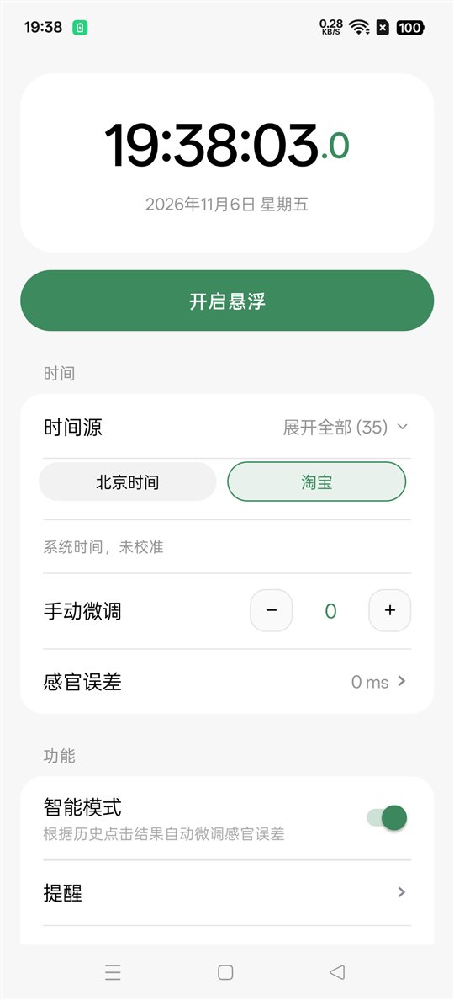
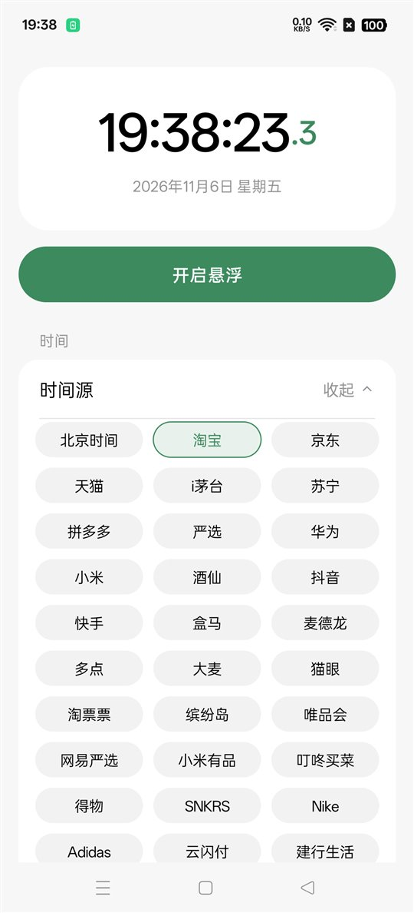
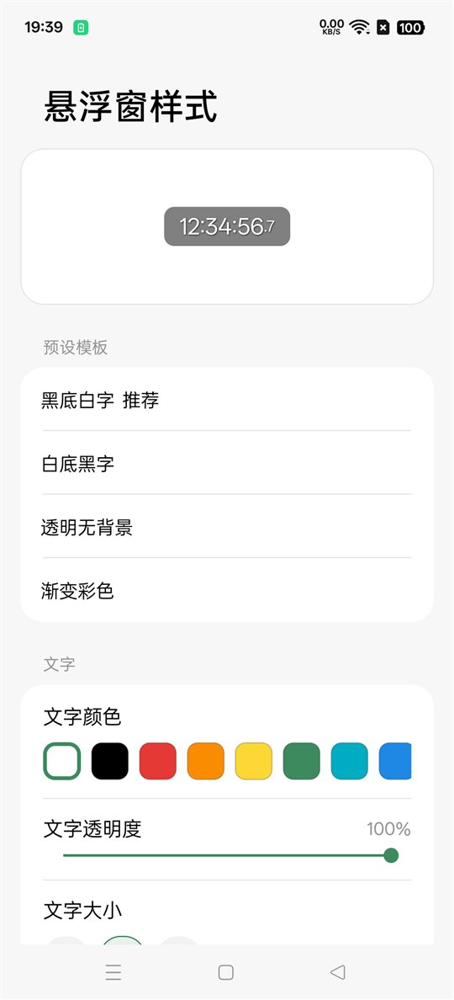
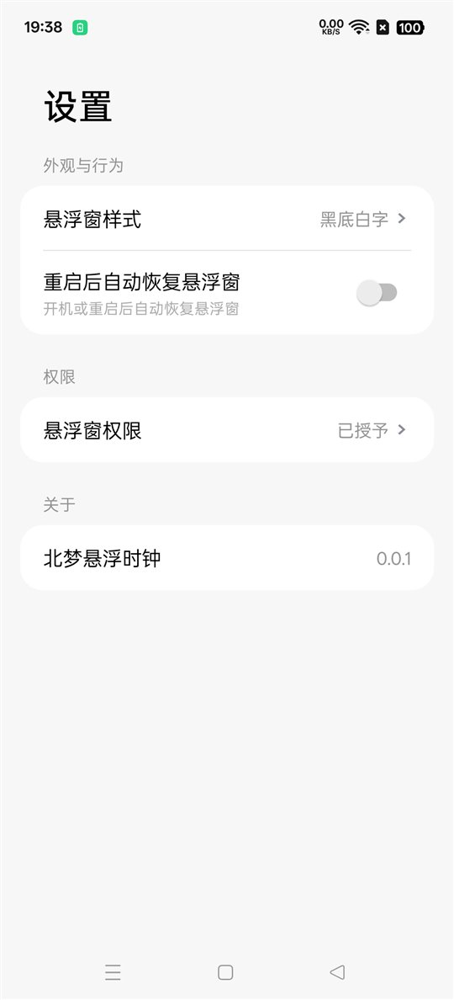
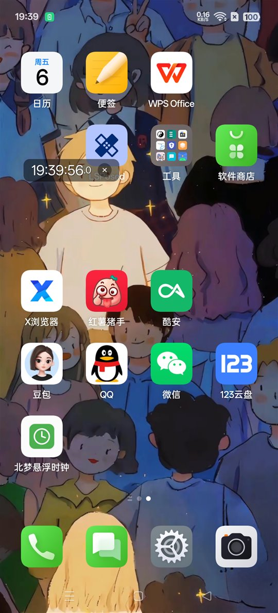

# 北梦悬浮时钟 · Beimeng Clock

极简 Android 悬浮时钟。毫秒级精度、35 个电商平台时间源校准、样式完全可定制，
**零广告、零第三方 SDK、零隐私弹窗**。

[](../../releases)
[](../../releases)
[](../../releases)
[](../../releases)
[](LICENSE)

---

## 预览

| 主页 | 时间源（展开 35 个） |
|---|---|
|  |  |

| 悬浮窗样式 | 设置 |
|---|---|
|  |  |

| 悬浮窗实际效果 |
|---|
|  |

---

## 为什么又一个时钟 App

市面上同类工具有两类问题：

1. **广告塞满**：闹钟/时钟类工具常被优量汇、穿山甲、Bugly、友盟等 SDK 占据，
   体积 30 MB 起，启动页、插屏、悬浮条层层叠叠。
2. **精度糊弄**：只读系统时间，不跟服务器对时；抢购场景下差几百毫秒就是成功与失败。

这个项目只解决一件事：**在两三秒的窗口里，让你看到正确的毫秒。**

| | 常见工具 | 本项目 |
|---|---|---|
| APK 体积 | 30–60 MB | **91 KB** |
| 第三方 SDK | 广告/统计/崩溃上报全家桶 | **无，仅 Android framework** |
| 时间源 | 系统时间 / 号称"校准" | **35 个真实平台接口** |
| dex | 多 dex，数千类 | 1 个 dex，29 个类 |
| 隐私弹窗 | 首启强制同意 | 无 |

> SDK 检测方式：对 dex 做字符串检索，`pangle` / `bytedance` / `gdt` / `qq.e` /
> `bugly` / `umeng` / `kuaishou` / `mobads` / `com.google.android.gms` 全部不存在。
> 不是屏蔽，是没有打包进去。

---

## 功能

### 时间显示
- `时:分:秒.毫秒`，等宽字体渲染，秒数跳动不抖
- 毫秒独立着色（强调色）
- 北京时间源走 UTC+8 固定换算，不受设备时区影响

### 35 个时间源校准
默认收起，只显示「北京时间」「淘宝」两项；点标题行展开后三列铺满，可滚动查看全部。

```
北京时间  淘宝   京东   天猫   i茅台   苏宁   拼多多  严选
华为     小米   酒仙   抖音   快手    盒马   麦德龙  多点
大麦     猫眼   淘票票  缤纷岛  唯品会  网易严选 小米有品 叮咚买菜
得物     SNKRS  Nike  Adidas  云闪付  建行生活 小红书  微信
美团     饿了么  通用
```

每个源配多条候选接口，逐个尝试、首个成功即用；全失败才回落系统时间。
往返延迟按 `rtt/2` 补偿，时间戳秒/毫秒自动归一。

**接口实测延迟**（2026-11 于国内网络）：

| 源 | 接口 | 延迟 |
|---|---|---|
| 苏宁 | `f.m.suning.com/api/ct.do` | ~112 ms |
| 淘宝 | `acs.m.taobao.com/gw/mtop.common.getTimestamp` | ~646 ms |
| 大麦 | `mtop.damai.cn/gw/mtop.common.getTimestamp` | ~215 ms |
| 京东 | `a.jd.com//ajax/queryServerData.html` | ~285 ms |
| 抖音 | `www.douyin.com`（HTTP Date 头） | ~189 ms |
| 拼多多 | `www.pinduoduo.com`（HTTP Date 头） | ~802 ms |

### 误差补偿
- **手动微调**：±10 ms 步进，也可键盘输入任意值
- **感官误差**：从看到时间到手指落下的延迟，抢购时按此值提前
- **智能模式**：按历史点击结果自动微调（开关已就位，算法见「路线图」）

### 悬浮窗
- 可拖动，松手记忆位置
- 小 / 大两种模式，点击切换
- 前台服务常驻，通知栏可回到 App
- **只显示时间**，无应用名、无图标、无广告条

### 样式定制
- 4 套预设：黑底白字 / 白底黑字 / 透明无背景 / 渐变彩色
- 文字：12 色板 + 自定义十六进制、透明度 0–100%、三档字号
- 背景：颜色 / 透明度 / 圆角 0–24dp
- 阴影：开关 / 颜色 / 透明度 / 4 档偏移
- 改动实时预览，并即时下发到正在运行的悬浮窗

### 提醒
- 定时提醒：指定时刻，可设每天重复
- 倒计时提醒：1–599 分钟
- 均走系统通知，AlarmManager 精确定时

---

## 安装

```bash
# 从 Releases 下载
# 或本地构建后安装
adb install -r 成品/BeimengClock-v0.0.1.apk

# 首次使用需授予「显示在其他应用上层」
adb shell am start -a android.settings.action.MANAGE_OVERLAY_PERMISSION
```

- **最低 Android 7.0 (API 24)**，目标 Android 13 (API 33)
- 包名 `beimeng.clock`
- debug 签名，与官方版不兼容，安装前需卸载旧版

---

## 构建

不使用 Gradle，一条 PowerShell 脚本走完 `aapt2 → javac → d8 → 签名`，
产物只有 91 KB。这样做的原因：本项目零第三方依赖，Gradle 的复杂度没有收益。

### 依赖
| 组件 | 说明 |
|---|---|
| JDK 17 | 编译与签名 |
| `aapt2` | 从 apktool 抽取（仓库 `app/bin/` 未收录，见下方获取方式） |
| `android.jar` | API 34 平台包 |
| `r8.jar` | 提供 `d8` |

### 运行
```powershell
powershell -NoProfile -ExecutionPolicy Bypass -File build_clean.ps1
```

脚本会：
1. 把工程镜像到纯英文路径（**aapt2 无法处理含中文的路径**，这是硬限制）
2. 校验 smali/Java 完整性，类数不足直接中止，不产出残缺包
3. 依次执行编译、转 dex、打包、zipalign、签名
4. 校验 dex 数量、资源表、品牌字符串后才回收产物

### 相对 Gradle 的差异
- 无依赖解析，构建 < 10 秒
- 无 `BuildConfig` 自动生成，版本号在 `app/src/beimeng/clock/BuildConfig.java` 手写
- 无 R8 混淆（代码量小，混淆收益为零）

---

## 项目结构

```
.
├── app/
│   ├── AndroidManifest.xml
│   ├── src/beimeng/clock/
│   │   ├── MainActivity.java      主界面：时钟 / 时间源 / 微调 / 补偿
│   │   ├── SettingsActivity.java  设置
│   │   ├── StyleActivity.java     样式：预设 + 色板 + 滑杆
│   │   ├── RemindActivity.java    定时 / 倒计时
│   │   ├── FloatService.java      悬浮窗前台服务
│   │   ├── RemindReceiver.java    提醒广播与排程
│   │   ├── BootReceiver.java      开机恢复
│   │   ├── TimeSync.java          35 个时间源
│   │   ├── Style.java             样式模型与预设
│   │   ├── Prefs.java             偏好集中管理
│   │   └── BuildConfig.java       版本号
│   └── res/                       36 个资源文件
├── docs/screenshots/              界面预览
├── 成品/                          发布用 APK
└── build_clean.ps1                一键构建
```

---

## 设计

配色取自 HyperOS / Miuix 的分组卡片风格：浅灰底 `#F7F7F7` + 纯白卡片 `#FFFFFF`，
全站无投影，靠明度差分层，单一草木绿强调色 `#3D8A5F`。

| 令牌 | 值 |
|---|---|
| 页面底 | `#F7F7F7` |
| 卡片 | `#FFFFFF` |
| 分隔线 | `#E7E7E7` |
| 主文字 | `#000000` |
| 次级文字 | `#949494` |
| 强调色 | `#3D8A5F` |
| 分组卡片圆角 | 18 dp |
| 行内边距 | 18 dp（左右）/ 13–15 dp（上下） |

时钟用等宽字体（`monospace`）是硬要求 —— 比例字体下秒数宽度变化会让数字左右抖动。

---

## 路线图

- [ ] **智能模式算法**：当前只持久化开关，尚未接入按历史点击自动修正感官误差的逻辑
- [ ] 悬浮窗样式页的深色模式适配
- [ ] 时间源接口健康检查（自动跳过连续失败的源）
- [ ] 开机自启的 OEM 白名单引导（部分国产 ROM 需额外设置）
- [ ] 可选的 Release 签名与上架素材

---

## 已知限制

- **麦德龙**回落到通用源：`www.metro.cn` SSL 证书异常且 HTTP 协议握手失败，
  `cloud.metro.cn` / `m.metro.cn` / `metro.com.cn` 全部 DNS 解析失败，暂无可用入口。
- 部分平台用主站 HTTP `Date` 头取时，精度受 CDN 节点影响，通常 ±50 ms；
  需要更高精度时优先选苏宁、大麦这类返回 JSON 时间戳的接口。
- 未在 Android 7–9 真机验证（开发机为 Android 15）。

---

## 致谢

时间源接口来自各平台公开接口，仅供学习与个人对时使用。
特别感谢 [Sesame-M](https://github.com/aw1y2z/Sesame-M) 的界面设计语言提供了视觉参考。

## 许可

[MIT](LICENSE)
